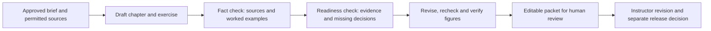

# AI+1: An Auditable Workflow for Drafting AI-Ready Textbook Chapters

*Revised rough manuscript for author review. The workflow and comparison are proposed. No comparative or learning outcomes are reported.*

## Abstract

An AI-generated textbook chapter may be readable before an instructor can tell whether its assertions are grounded, its examples work, or its assignments leave meaningful reasoning to the student. We present a chapter-drafting protocol that packages each draft with source-linked claims, independently checkable exercises, a readiness review, and explicit decisions for the instructor. We describe a proposed comparison with the current AI+1 workflow and a single-pass baseline. Each condition receives the same brief, sources, and output contract. The primary comparison asks whether the proposed workflow increases aligned, inspectable teaching evidence while keeping material factual errors within a prespecified tolerance. An existing smoke test on one constructed graph lesson illustrates the difference between a machine readiness signal and evidence a reviewer can actually inspect. The smoke test does not evaluate generated chapter quality or learning.

## 1. Introduction

A chapter near the beginning of a course needs to do more than state a correct answer. It needs to give students a problem they can attempt, a reason to try a particular method, and a way to find out where their reasoning failed. When students can delegate part of that task to a model, the boundary between support and substitution has to be visible in the material. A chapter that introduces breadth-first search (BFS), for instance, can ask for a queue prediction before exposing either the worked trace or an AI prompt. The same chapter can then ask students to check a model-produced trace by stepping through the graph and finally explain a changed case without the model. These are different opportunities for learning, not interchangeable prompts.

AI+1 already separates several production activities and treats the human author as responsible for the blueprint, substantive rewrite and release. The proposed addition organizes a machine-produced review packet around what the instructor needs to check before that rewrite. The design borrows the staged outline, source work, separate figure work and refinement pattern documented in [PaperOrchestra](https://arxiv.org/html/2604.05018v1); its scientific-paper benchmark does not establish teaching quality. [NEEDS: primary studies on independent verification, AI-assisted textbook authoring and instructional alignment, including contrary evidence; this draft does not establish novelty across those literatures.]

[ASSUMPTION: The initial evaluation is for instructors reviewing first-draft chapters, not students evaluating a finished course.] The testable question is whether the added handoffs improve reviewable objective coverage over the current AI+1 path without a meaningful rise in material errors under comparable generation and review budgets.

## 2. Proposed chapter workflow

The input is a versioned brief: audience, prerequisites, objectives, approved sources, access constraints, permitted reuse, and what must be done independently. The output is editable prose and an evidence packet. Research binds material claims to source passages or independent checks. Drafting reuses approved material before filling gaps, and keeps private answer keys separate. Fact-checking covers assertions and worked examples; the readiness pass records where a design requirement is visible and where it still depends on instructor choices. Revision carries unresolved items forward rather than accepting them by default.

Figure 1 shows the sequence and the distinction between the draft being assessable and authorized for release.

**Figure 1. Proposed chapter handoff, not a deployed pipeline.** The diagram shows the sequence from permitted inputs through factual and readiness checks to a separate instructor decision. The output of the automated lane is a draft packet; even a complete packet does not authorize publication, student exposure or LMS import. **Alt text:** Seven boxes run from approved inputs through drafting, two audits and revision to an editable packet and a human decision. **Source:** [Chapter-drafting protocol](../workflow.md).

The [AI Readiness framework](https://github.com/nikbearbrown/ai-readiness/blob/2c0c51ef090230aacaf0d45e0b2a141c39e125b6/docs/framework.md) distinguishes rules and disclosure, an independent first attempt, meaningful disciplinary AI use, judgment and verification, graded process, and independent assessment. A reviewer records the exact artifact location, what the artifact shows, what it cannot show, and who can resolve the gap. Keep “not supplied” distinct from “not applicable,” with the latter decided from the brief rather than by the producing model. An instructor-supplied policy and actual course grading remain outside an isolated chapter unless documented. [Export and design notes](../exports-and-design.md) distinguish a mechanically valid draft package from an approved or imported course.

## 3. Proposed evaluation

### Units, controls and freezing

Use permissioned or synthetic chapter briefs with different content and difficulty. Freeze source packets, objectives, independent check cases, permissions, and objective-level scoring instructions before generation. Separate development and evaluation by shared source family and near-duplicate problem templates. A brief is the paired unit: it is assigned to every arm, and multiple reviewers or claims within a chapter are not independent replicates.

| Arm | Procedure | Interpretation |
| --- | --- | --- |
| A | Single-pass draft using the shared output fields and source packet | Complete staged path versus a simple baseline |
| B | Current AI+1 drafting path frozen at a stated review checkpoint | Comparator for incremental change |
| C | Same checkpoint with the proposed early fact-check, readiness handoffs and evidence-driven revision | Effect of the bundled additions, not of any single stage |

[ASSUMPTION: The study can operationalize a pre-rewrite checkpoint for the existing path without changing its documented release gates.] Provide each arm with identical upstream human input, permitted retrieval and the same deliverable fields. Normalize presentation and randomize order for content review. Score report usability separately because the packet format can reveal the arm. Record model version, tool settings and resource ceilings, effective tokens, latency, retries, and staff time. If generation-time controls materially alter the baseline, report that departure and treat a naturalistic comparison separately.

### Outcomes and decision rule

Define reviewable coverage as the fraction of eligible, prespecified objectives with a visible attempt, aligned exercise or check, and enough evidence to reproduce the judgment. Require the rubric to distinguish a reference to an exercise from a usable exercise. Freeze denominators from the registered brief and report unsupported objectives even when an arm omits them. Audit factual claims and worked answers independently from the coverage assessment, documenting what counts as a material error. Report material errors per assigned brief and per checked claim, with assessed-claim and failed-packet counts; neither missing claims nor failed drafts count as successful evidence. Report completion rates and best/worst bounds for an unavailable audit rather than imputing missing error values as zero.

The primary paired contrast is C versus B. A positive decision requires both an improvement in readiness coverage and an upper uncertainty bound for excess material errors below the prespecified noninferiority margin. C versus A, review time, accessibility, source entailment and independent assessment suitability are secondary. Double-score a planned subset with subject and instructional reviewers and report agreement before adjudication. Summarize uncertainty at the brief level, respecting shared source families. [NEEDS: independent rubric calibration, source-family count, tolerance and minimum useful coverage increment, feasibility estimates, and a frozen analysis plan before the confirmatory comparison.]

## 4. Current evidence: a mechanical smoke test

The existing [pilot receipt](../pilot.md) reports an ARC scan of [one constructed BFS lesson](../pilot-chapter.md), with one detected module and one page, and no detected assignments, quizzes or rubrics. The lesson includes a prediction prompt, but the answer appears in the next sentence. The receipt marks the first-attempt signal as CHECK, while the human inspection identifies a design repair: move the answer behind the attempt. It also reports no actual syllabus policy or grading evidence. These are reported by the repository's receipt; the present manuscript review did not rerun ARC.

The example illustrates why the proposed reviewer must inspect evidence at its actual location. It does not estimate diagnostic accuracy across chapters, compare arms, establish accessibility, validate an LMS import, or show that any student can transfer the reasoning.

## 5. Discussion and limits

The immediate deliverable is a chapter that an instructor can inspect, not approval or learning. Reviewable evidence and learning may diverge: a well-documented exercise can still fail when taught, and a thinly documented chapter can work with a capable teacher. Separate measured draft properties, instructor decisions, what is delivered, and independently observed learning. An eventual learning study needs a new design and appropriate institutional review before recruitment. No participant records or production data are necessary for the proposed draft comparison.

Readiness judgments may favor mechanically observable teaching features and may fail to travel across subjects, course access arrangements or institutions. The first comparison cannot isolate individual stages of the bundled extension; a later budget-matched ablation could test that mechanism. Comparative figures and substantive performance claims remain blocked on observed data and a traceable analysis.

## References and status

- Song, Song, Pfister and Yoon, *PaperOrchestra*, [preprint cited by the base manuscript](https://arxiv.org/abs/2604.05018).
- [AI+1 constitution and Conductor](../sources.md), [chapter protocol](../workflow.md), and [AI Readiness source inventory](../sources.md).
- [NEEDS: author list, relevant disclosures and approved venue before submission.]
